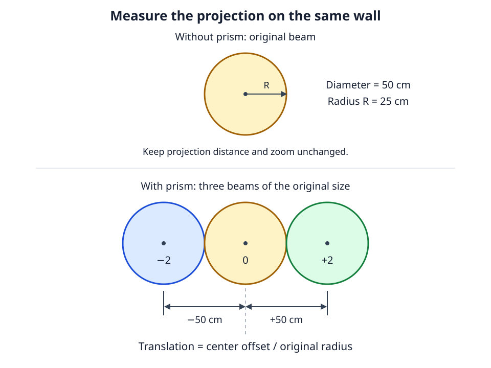

# Prism Definition

A prism is defined by one `<Facet>` entry per projected beam in a wheel slot.
Each facet's `Rotation` matrix describes the rotation, translation and scaling
of a copy of the unaltered beam.

## Translation units

Facet translation is expressed in units of the **radius of the unaltered beam**.
A translation of `1` moves the center of a facet's beam by one original beam
radius; `2` moves it by one original beam diameter. Use the unaltered beam as
the reference even if the facet scales its copy of the beam.

To obtain these values from a real fixture, project onto a wall and measure the
unaltered beam diameter and the offsets of the facet beam centers from the
unaltered beam center. Keep the projection distance and zoom setting the same
for both measurements, and use the same length unit throughout:

```text
R = unaltered beam diameter / 2
Horizontal translation = horizontal center offset / R
Vertical translation   = vertical center offset / R
```

For example, if the unaltered beam is 50 cm in diameter, its radius is 25 cm.
A facet projected 50 cm to the right of the original center has a horizontal
translation of `50 / 25 = 2`. A facet 50 cm to the left has a translation of
`-2`. These are relative values, so the matrix contains `2` or `-2`, rather
than a distance in centimeters.

## Three-facet linear prism

The diagram shows a wall projection before and after inserting a prism. Each
facet preserves the original beam size. The outer beams touch the center beam
because their centers are one original diameter apart.



For this example, define the three facets inside the prism's wheel slot as:

```xml
<Facet Rotation="{1, 0, 0},{0, 1, 0},{-2, 0, 1}"/>
<Facet Rotation="{1, 0, 0},{0, 1, 0},{ 0, 0, 1}"/>
<Facet Rotation="{1, 0, 0},{0, 1, 0},{ 2, 0, 1}"/>
```

## Reading the matrix

The serialized form is:

```text
{M11, M12, M13},{M21, M22, M23},{M31, M32, M33}
```

For a facet with scaling and translation only, use:

```text
{scaleX, 0, 0},{0, scaleY, 0},{offsetX, offsetY, 1}
```

The first two groups control scaling and rotation; the first two values in the
last group are the horizontal and vertical translations. For example, the
right-hand facet above has `offsetX = 2` and `offsetY = 0`. Its equivalent
matrix acting on a column vector is:

```text
| 1  0  2 |   | x |   | x + 2 |
| 0  1  0 | × | y | = | y     |
| 0  0  1 |   | 1 |   | 1     |
```

Scaling is also relative to the unaltered beam. For example, a facet producing
a 30 cm diameter beam from the original 50 cm diameter beam uses
`scaleX = scaleY = 30 / 50 = 0.6`. Its translation still uses the original
25 cm radius as the reference.

See the [Handle Prisms help page](https://gdtf-share.com/help/users/gdtf_howto/prism_facets/index.html)
for the GDTF Builder controls and further examples.
